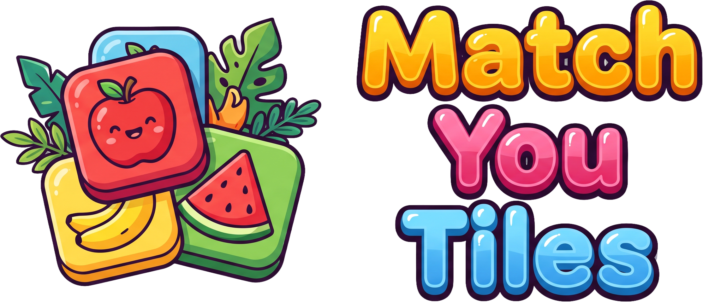

# Match You Tile

<p align="center">
  
</p>

Game puzzle 2D berbasis **Python dan Pygame-CE**. Cocokkan tiga kartu buah,
sayuran, bumbu, atau makanan untuk membersihkan papan, mengumpulkan kombo,
dan menyelesaikan 1.000 level.

## Fitur

- Tujuh slot yang diisi dari kiri ke kanan, dengan kartu sejenis dikelompokkan.
- 1.000 level: Mudah, Sedang, Sulit, dan Level Gila setiap kelipatan sepuluh.
- Delapan variasi tumpukan, termasuk gunung, lingkaran, spiral, dan gelombang.
- 24 ilustrasi kartu SVG serta tombol bergaya kartun.
- Animasi kartu, pemusnahan, perapatan slot, dan intro level transparan.
- Kombo hingga **×5**, dengan indikator waktu dan bonus skor.
- Bantuan Kembalikan, Cocok Otomatis, dan Acak.
- Latar permainan acak serta musik berkelanjutan dari menu ke permainan.
- Delapan bahasa dan tiga pengatur volume independen.
- Progres, bahasa, dan volume tersimpan secara lokal.
- Tampilan potret **540 × 960** yang menyesuaikan ukuran jendela.
- Build executable Windows dengan ikon aplikasi sendiri.

## Menjalankan dari kode sumber

### Kebutuhan

- Python **3.10 atau lebih baru**; lingkungan pengembangan menggunakan Python 3.14.2.
- Pygame-CE **2.5.8**, tercantum di [requirements.txt](requirements.txt).
- Lingkungan pengembangan dan build saat ini: **Windows 64-bit**.

Dari terminal pada folder proyek, buat lingkungan virtual dan jalankan game:

```powershell
python -m venv .venv
.\.venv\Scripts\python.exe -m pip install -r requirements.txt
.\.venv\Scripts\python.exe main.py
```

Jika dependensi sudah tersedia pada Python yang digunakan:

```powershell
python main.py
```

Tidak diperlukan koneksi internet saat bermain. Aset SVG dirender oleh
Pygame-CE; tidak memerlukan library konversi SVG tambahan.

## Cara bermain

1. Klik tombol level di menu utama untuk memulai level aktif.
2. Ambil kartu dari papan. Kartu yang tertutup **paling banyak 15%** masih dapat
   dipilih; jika lebih, ambil kartu penutupnya terlebih dahulu.
3. Kartu masuk ke tujuh slot di atas papan dan bergabung dengan kelompok sejenis.
4. Tiga kartu dengan gambar sama dimusnahkan. Setelah pemusnahan selesai, kartu
   lainnya baru bergeser ke kiri.
5. Bersihkan seluruh papan untuk menang. Jika tujuh slot terisi tanpa kecocokan,
   permainan berakhir dengan kalah.

Klik cepat tetap dapat dilakukan selama animasi kartu. Saat tersisa tiga slot
atau kurang, bilah memberikan peringatan visual. Peringatan slot dan pemusnahan
kartu **tidak menggunakan efek suara**.

Menang membuka level berikutnya. Level sebelumnya tidak dapat dimainkan kembali;
level aktif dapat diulang jika kalah. Tombol Menu atau Esc saat bermain membuka
konfirmasi: keluar ke menu dihitung kalah, sedangkan batal melanjutkan papan yang sama.

### Kontrol dan bantuan

| Kontrol | Fungsi |
| --- | --- |
| Klik kiri | Memilih kartu atau tombol |
| **Z** / ikon Kembalikan | Mengembalikan kartu terakhir yang belum musnah ke posisi asal |
| **C** / ikon Cocok | Mengambil pelengkap dan menyelesaikan satu kelompok secara otomatis |
| **R** / ikon Acak | Mengacak gambar pada kartu yang masih di papan |
| **Esc** | Konfirmasi kembali ke menu, atau menutup satu lapisan modal |
| Ikon roda gigi | Membuka Pengaturan di menu atau selama bermain |
| Ikon speaker | Langsung membuka modal volume |

Bantuan dapat digunakan tanpa batas selama permainan berlangsung. Cocok Otomatis
memprioritaskan jenis terbanyak di slot; jika seri, kelompok paling kiri.
**Khusus saat satu slot kosong dan keenam kartu berbeda**, bantuan memprioritaskan
kartu paling kanan, mengambil dua pelengkap, dan menyelesaikan kelompok sebagai
satu transaksi tanpa memicu kalah sementara. Pelengkap boleh berasal dari kartu tertutup.

Acak mempertahankan jumlah setiap jenis dan isi slot. Cabang berbias berpeluang
65% menampilkan gambar yang sesuai slot pada kartu yang dapat dipilih jika
tersedia. Cabang pengacakan biasa tetap mungkin menghasilkan kecocokan alami.

### Skor dan kombo

Nilai dasar setiap kartu adalah 100 poin, sehingga satu kelompok menghasilkan
300 poin. Kecocokan manual berikutnya dalam **lima detik** meningkatkan pengali:

| Pengali | Poin per kelompok |
| --- | ---: |
| ×1 | 300 |
| ×2 | 600 |
| ×3 | 900 |
| ×4 | 1.200 |
| ×5 | 1.500 |

Waktu habis atau bantuan yang berhasil digunakan memutus kombo. Membuka
Pengaturan atau konfirmasi keluar menjeda timer. Skor dimulai dari nol saat level
dimulai ulang. Aturan lengkap ada di [KOMBO.md](dokumentasi/KOMBO.md).

## Level dan kesulitan

| Level/kategori | Jenis gambar |
| --- | ---: |
| Level 1–3, pengenalan | 3 |
| Mudah: level 4–333 | 5–7 |
| Sedang: level 334–666 | 8–10 |
| Sulit: level 667–1.000 | 11–13 |
| Gila: setiap kelipatan 10 | 12–18 |

Level Gila menggantikan kategori biasa pada nomor tersebut. Total tetap
1.000 level: 900 level biasa dan 100 Level Gila.

Generator membatasi papan pada **27–90 kartu**, dengan jumlah jenis dan
kepadatan yang meningkat. Semua jenis dalam profil dijamin muncul dalam
kelipatan tiga. Papan awal mempunyai urutan solusi; pengacakan bantuan tidak
menjamin urutan solusi tanpa bantuan setelahnya.

Indeks kesulitan merupakan perkiraan desain, bukan persentase peluang menang.
Bantuan bebas dapat mengurangi tantangan. Rumus dan hasil audit tersedia di
[KESULITAN_LEVEL.md](dokumentasi/KESULITAN_LEVEL.md) dan
[profil_level.csv](dokumentasi/profil_level.csv).

## Bahasa dan audio

**Pengaturan → Bahasa** menyediakan Indonesia, Inggris, Spanyol, Prancis,
Jerman, Portugis, Mandarin, dan Jepang. Teks antarmuka serta pesan permainan
mengikuti bahasa pilihan; logo gambar tetap menjadi nama game.

**Pengaturan → Volume** menyediakan slider, tombol **−/+**, dan tombol bisu:

| Pengatur | Cakupan |
| --- | --- |
| Suara game | Pemilihan kartu, Kembalikan, dan Acak |
| Suara sistem | Klik, intro, hasil, dan aksi yang ditolak |
| Musik latar | Lagu yang sama pada menu dan permainan |

Ketiganya dapat diatur secara terpisah dari 0–100%. Tombol −/+ mengubah nilai
sebesar 5%. Musik aktif adalah `Paths_Through_Silver_Leaves.wav`, hasil konversi
MP3 yang disediakan untuk proyek; lagu tidak dimulai ulang saat berganti halaman.

Mandarin/Jepang memakai font CJK sistem: Microsoft YaHei pada Windows atau
Noto Sans CJK pada lokasi Linux yang didukung. Panduan lengkap ada di
[PENGATURAN.md](dokumentasi/PENGATURAN.md) dan [AUDIO.md](dokumentasi/AUDIO.md).

## Penyimpanan data

| Cara menjalankan | Lokasi data |
| --- | --- |
| Sumber Python | `data/` di folder proyek |
| Executable Windows | `%LOCALAPPDATA%\MatchYouTile\` |

Data terdiri dari `progres.json`, `pengaturan.json`, dan `audio.json`.
Data pemain tidak disertakan dalam build executable. Jangan menghapus berkas
tersebut jika ingin mempertahankan progres dan pengaturan.

## Build Windows `.exe`

```powershell
.\.venv\Scripts\python.exe -m pip install -r requirements-build.txt
.\.venv\Scripts\python.exe peralatan/buat_exe.py
```

Build memakai [MatchYouTile.spec](MatchYouTile.spec) dan menghasilkan satu file:

```text
dist/MatchYouTile.exe
```

Executable Windows 64-bit menyertakan aset serta runtime Python, sehingga pemain
tidak perlu memasang Python. Ikon executable berasal dari `assets/logo.ico`.
Folder `dist/`, `build/`, dan alat build lokal tidak dilacak Git; hasil build
harus dibuat atau dibagikan secara terpisah.

**Status validasi:** build terbaru berhasil dibuat, tetapi peluncurannya di
lingkungan pengembangan diblokir oleh Application Control Windows. Pemeriksaan
melalui kode sumber berhasil; eksekusi executable terbaru belum terverifikasi.
Rincian ada di [BUILD_WINDOWS.md](dokumentasi/BUILD_WINDOWS.md).

Game saat ini masih menggunakan **Pygame-CE**. Migrasi Kivy dan paket Android
APK/AAB belum diimplementasikan.

## Pengujian dan audit

```powershell
python -m unittest discover -s tests -q
python audit_level.py
python main.py --uji-paket dist/hasil_uji_sumber.json
```

- Validasi terakhir: **72 pengujian lulus**.
- Audit membuat satu papan berbenih tetap per level dan memeriksa batas layar,
  jenis gambar, serta penyelesaiannya. CSV audit ditulis ulang saat skrip dijalankan.
- Mode `--uji-paket` memeriksa aset, audio, bahasa, modal, level 1.000, dan
  konfirmasi keluar menggunakan driver dummy serta data sementara.
- Pengujian otomatis tidak menggantikan pengujian pengalaman bermain dan
  penilaian suara melalui perangkat nyata.

## Struktur proyek

```text
match_you_tile/
├── main.py                    # Titik masuk aplikasi
├── audit_level.py             # Audit 1.000 papan dan ekspor CSV
├── permainan/
│   ├── antarmuka.py            # Tampilan, input, dan integrasi game
│   ├── model.py                # Kartu, slot, bantuan, skor, dan kombo
│   ├── level.py                # Profil kesulitan 1–1.000
│   ├── animasi.py              # Gerakan per kartu
│   ├── aset.py                 # Pemuat SVG dan cache tombol
│   ├── latar.py                # Latar menu dan undian latar game
│   ├── audio.py                # Musik, efek, volume, dan bisu
│   ├── bahasa.py               # Terjemahan dan preferensi bahasa
│   ├── pengaturan.py           # Modal bertingkat dan slider
│   ├── progres.py              # Penyimpanan level aktif
│   ├── lokasi.py               # Lokasi data sumber/executable
│   └── uji_paket.py            # Pemeriksaan paket tanpa jendela
├── assets/                    # Gambar, SVG, terjemahan, dan audio
├── data/                      # Data pemain lokal, diabaikan Git
├── tests/                     # Pengujian otomatis
├── peralatan/                 # Pembuatan audio sintetis dan executable
├── dokumentasi/               # Panduan dan riwayat pengembangan
├── MatchYouTile.spec           # Konfigurasi PyInstaller
├── requirements.txt           # Dependensi runtime
├── requirements-build.txt     # Dependensi build
├── instruksi.md               # Panduan kerja proyek
├── konsep_game.txt            # Konsep dari pemilik proyek
└── LANJUTKAN.md               # Titik lanjut sesi pengembangan
```

## Dokumentasi

| Dokumen | Isi |
| --- | --- |
| [Panduan](dokumentasi/PANDUAN.md) | Cara bermain dan menjalankan game |
| [Arsitektur](dokumentasi/ARSITEKTUR.md) | Variabel, fungsi, dan alur kode |
| [Kesulitan level](dokumentasi/KESULITAN_LEVEL.md) | Generator, kategori, dan rumus kesulitan |
| [Kombo](dokumentasi/KOMBO.md) | Timer, pengali, dan bonus skor |
| [Pengaturan](dokumentasi/PENGATURAN.md) | Bahasa, modal, dan volume |
| [Audio](dokumentasi/AUDIO.md) | Musik, efek, dan konversi WAV |
| [Aset SVG](dokumentasi/ASET_SVG.md) | Koleksi ilustrasi kartu |
| [Tombol SVG](dokumentasi/TOMBOL_SVG.md) | Ikon dan latar tombol |
| [Build Windows](dokumentasi/BUILD_WINDOWS.md) | Executable dan penyimpanan data |
| [Riwayat](dokumentasi/RIWAYAT_PENGEMBANGAN.md) | Keputusan dan perkembangan proyek |
| [Lanjutkan sesi](LANJUTKAN.md) | Status terakhir dan catatan untuk sesi berikutnya |
